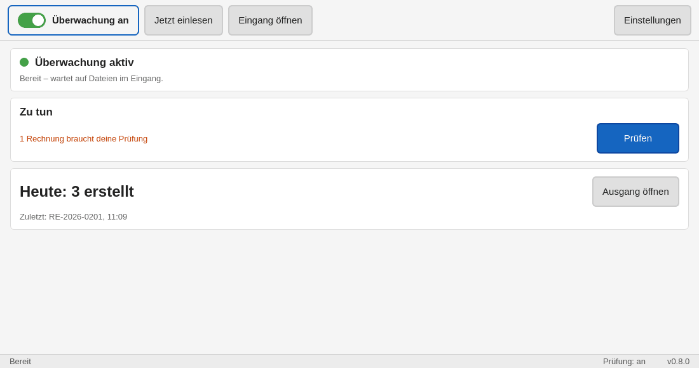
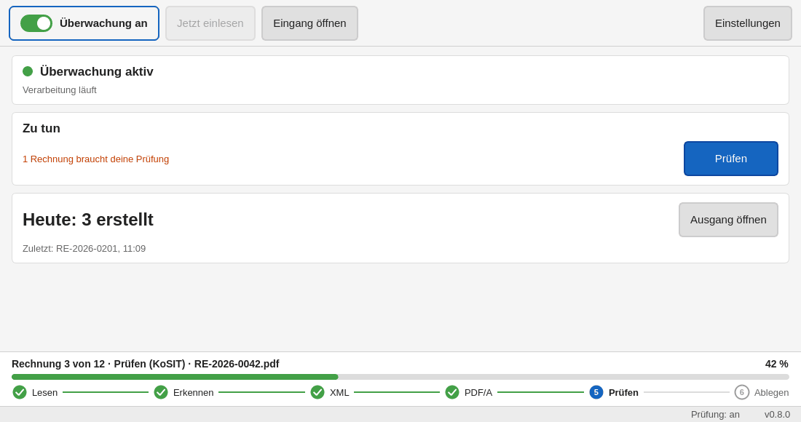
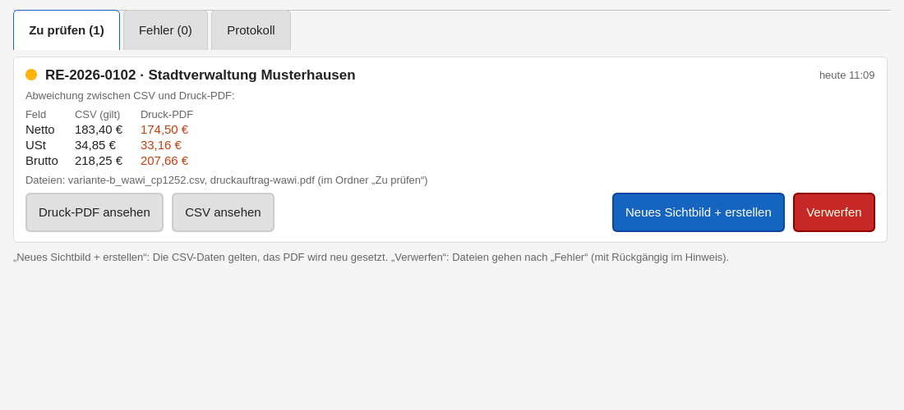
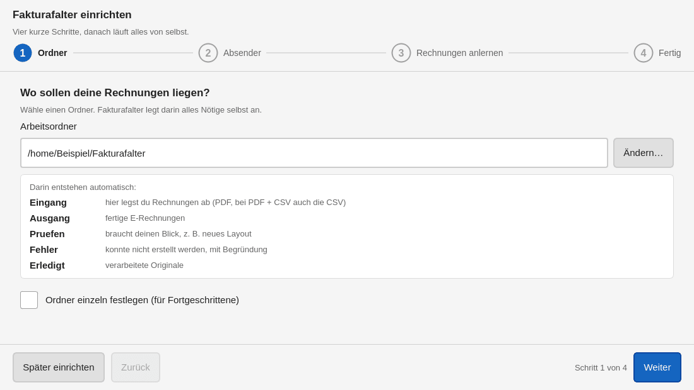

<p align="center">
  
</p>

<h1 align="center">Fakturafalter</h1>

<p align="center"><b>CSV / XML / PDF rein. ZUGFeRD raus. Lokal geprüft.</b><br>
validiert nach EN 16931 und PDF/A-3</p>

<p align="center">
  
</p>

Fakturafalter macht aus den Rechnungsexporten deiner Warenwirtschaft oder deines ERP gültige E-Rechnungen. Die
Exporte kommen als CSV oder XML, heraus kommt ZUGFeRD: PDF/A-3 mit eingebetteter XML nach EN 16931. Es überwacht
einen Eingangsordner, erzeugt und prüft jede Rechnung lokal und legt sie im Ausgang ab. Von dort übernimmt sie
dein Archiv (z. B. ELO), ein anderes Programm oder du selbst.

Gedacht für kleine Betriebe, deren Warenwirtschaft keine E-Rechnung kann. Fakturafalter läuft im Hintergrund auf
einem Arbeitsplatz-PC oder ohne Oberfläche (`--headless`), z. B. auf einer VM. Die Rechnungsnummern vergibt
weiterhin dein System.

## Warum Fakturafalter

- **Lokal.** Rechnungsdaten verlassen den Rechner nicht, ohne Cloud und ohne Telemetrie.
- **Geprüft, bevor etwas rausgeht.** Jede Rechnung wird nach der Erstellung lokal geprüft: mit Mustang (mit
  veraPDF) für PDF/A-3 und ZUGFeRD, mit dem KoSIT-Validator für die Rechnungsdaten nach EN 16931. Dazu kommen
  Pflichtangaben und Plausibilität (§ 14 Abs. 4 UStG, Summen, doppelte Nummern).
  - Unklares landet in „Zu prüfen“, Ungültiges in „Fehler“ – nichts geht still raus.
  - In den Ausgang kommt nur die fertige, geprüfte Datei. Archiv oder andere Programme dürfen ihn jederzeit
    leeren; das Protokoll liegt getrennt im Ordner `Protokoll`.
- **Kostenlos und offen.** Apache-2.0, für Windows und Linux. Java-Laufzeit und Prüfwerkzeuge sind im Paket
  enthalten.
- **Passt sich an.** CSV-Assistent für eigene Exporte – auch Dateien mit mehreren Blöcken und eigener Kopfzeile.
  Profile in den Einstellungen an- und ausschalten, in fester Reihenfolge prüfen. Layout-Editor für die Sichtseite.
  Optional Prüfmuster für die Rechnungsnummer und eigene Dateinamen.

## In drei Schritten

1. **Herunterladen und starten.** Unter [Releases](https://github.com/deciderino/fakturafalter/releases):
   - Linux: das AppImage ausführbar machen und starten.
   - Windows: das ZIP entpacken und `Fakturafalter.exe` starten.

   Ein kurzer Assistent fragt nach Arbeitsordner und Absender.
2. **Eingang einrichten.** Einstellungen → Eingang & Vorlagen:
   - **CSV**: „Neue CSV einrichten…“ mit einer echten Export-Datei. Der Assistent erkennt, ob jede Zeile eine
     Position ist, ob die Datei Blöcke mit eigener Kopfzeile hat, oder ob eine Satzart-Spalte Kopf und Positionen
     trennt. Spalten prüfen, Probe und optional die Sichtseite ansehen, speichern. Unter Einstellungen siehst du
     je Profil, was es erkennt; mit „Profil testen…“ prüfst du, welches Profil eine Datei lesen würde.
   - **XML** (ZUGFeRD / XRechnung, CII oder UBL): Eine Zuordnung ist nicht nötig.
3. **Überwachung einschalten.** Exporte in den Ordner `Eingang` legen. Die geprüfte ZUGFeRD-PDF liegt im
   `Ausgang`, die Quelle wandert nach `Erledigt`.

Ausführlich: [Handbuch](docs/handbuch.md) · Schnellstart [CSV](docs/handbuch.md#3-schnellstart-csv) und
[XML](docs/handbuch.md#4-schnellstart-xml).

## So sieht es aus

Die Screenshots zeigen ausschließlich erfundene Beispieldaten.

**Im Alltag:** Hauptfenster mit aktiver Überwachung und Fortschritt während der Verarbeitung.





**Wenn etwas unklar ist:** Die Prüfansicht zeigt, was fehlt oder abweicht.



**Einrichten und gestalten:** Einrichtungsassistent und Layout-Editor für die Sichtseite.




## Eingangsformate

| Eingang | Empfehlung | Hinweis |
|---|---|---|
| **CSV** (Export aus Warenwirtschaft/ERP) | empfohlen | Zuordnung einmal mit dem CSV-Assistenten; Format siehe [csv-format.md](docs/csv-format.md) |
| **XML** (ZUGFeRD / Factur-X, XRechnung; CII oder UBL) | empfohlen | ohne Zuordnung; andere XML-Formate (z. B. DATEV, Lexware) werden nicht gelesen |
| **CSV oder XML + Original-PDF** | optional | Haken „Zusätzlich das PDF der Rechnung verwenden“: der Original-Druck bleibt die Sichtseite |
| **Nur PDF** | unterstützt, nicht empfohlen | siehe unten |

**Ausgabe:** ZUGFeRD als PDF/A-3 (Profil EN 16931, eingebettete `factur-x.xml`), optional zusätzlich eine
XRechnung (CII), wenn der Kundenstamm sie verlangt – neben der PDF, im Unterordner `XRechnung` oder gar nicht
(Einstellungen → Ausgabe). Weitere Funktionen:
- Kundenbezeichnung 1–3 als eigene Adresszeilen.
- Artikel-, Zeichnungs- und Bestellangaben unter der Positionsbezeichnung.
- Rabatte, Gutschriften und Lastschrift.
- Steuer-Sonderfälle: Reverse Charge (§ 13b UStG), innergemeinschaftliche Lieferung, Ausfuhr, nicht steuerbare
  Leistungen und Kleinunternehmer (§ 19 UStG) – auch gemischt in einer Rechnung und im Modus Nur PDF anlernbar.
- Rechnungen in Fremdwährung (z. B. USD) mit der Umsatzsteuer zusätzlich in EUR; der Kurs kommt aus deinen Daten,
  Fakturafalter ruft keinen Kurs ab.
- Leitweg-ID (XRechnung) mit Prüfziffer nach Mod 97-10.

**Nur PDF** (Angaben allein aus dem Rechnungsdruck) wird weiterhin unterstützt, ist aber nicht der empfohlene Weg:
Die Erkennung kann fehlgehen, Layouts müssen angelernt und Ergebnisse kontrolliert werden.
Ist Fakturafalter richtig eingerichtet und entspricht das Eingangs-PDF den Anforderungen (Text-PDF, angelernte
Vorlage, gleichbleibendes Layout), lässt sich auch mit reinen PDFs ein sicherer Ablauf aufbauen – jede Rechnung
durchläuft dieselben Pflicht- und Validierungsprüfungen und landet bei Unsicherheit in „Zu prüfen“.
Details im [Handbuch](docs/handbuch.md#nur-pdf-unterstutzt-aber-nicht-empfohlen).

## Datenschutz und Netz

- Alle Rechnungsdaten werden ausschließlich lokal verarbeitet. Einziger Netzzugriff ist die optionale
  Updateprüfung, die nur die aktuelle Versionsnummer bei GitHub abfragt und keine Daten sendet; abschaltbar
  (Einstellungen → Allgemein → Updates). Heruntergeladen wird nichts – bei einer neueren Version erscheint nur ein
  Hinweis mit Link.
- Die Prüfwerkzeuge (Java-Laufzeit, Mustang, KoSIT mit XRechnung-Konfiguration) sind im Paket enthalten. Zur
  Laufzeit wird nichts nachgeladen, und es gibt keine Telemetrie.
- Die Logdatei lässt sich anonymisieren (Einstellungen → Allgemein → „Logs anonymisieren“): Namen, Anschriften,
  IBAN, USt-IdNr. und Beträge erscheinen dann als Platzhalter.

## Lizenz und Haftung

Freie Open-Source-Software unter [Apache-2.0](LICENSE), Drittkomponenten in [NOTICE](NOTICE). Ohne Gewährleistung
und ohne Support. Die eingebaute Prüfung ersetzt nicht deine eigene Kontrolle der Rechnungen vor dem Versand.

## Entstehung

Konzept und Idee: deciderino. Code: geschrieben von der KI Grok Bot.

## Mehr

- [Handbuch](docs/handbuch.md) – Einrichtung und Alltag, Prüfungen, Gutschrift, häufige Probleme
- [docs/details.md](docs/details.md) – Eingabevarianten, Prüfung, Layout-Editor, Rechnungsnummer und Dateiname,
  Ordner und Protokoll, PDF-Erkennung
- [docs/csv-format.md](docs/csv-format.md) – CSV-Spalten und Profile

### Entwickeln

```bash
python -m venv .venv && .venv/bin/pip install -e ".[gui,test]"
fakturafalter
QT_QPA_PLATFORM=offscreen .venv/bin/pytest -q
```

Das Schema-GIF oben entsteht mit `python tools/readme_gif.py` (Pillow, Schrift Liberation Sans aus dem Paket).
