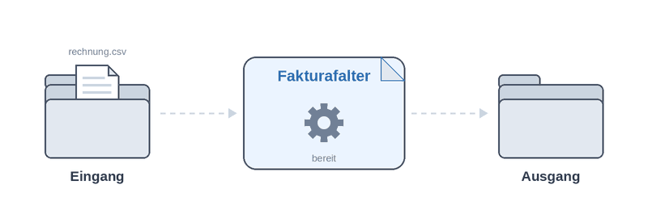
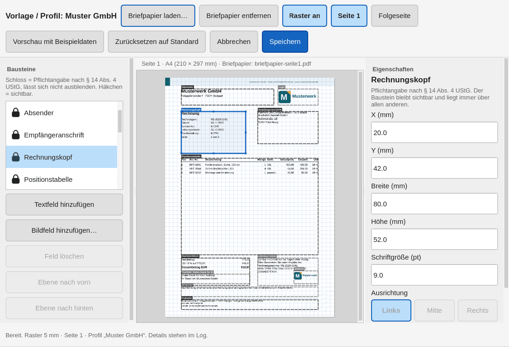

<p align="center">
  
</p>

<h1 align="center">Fakturafalter</h1>

<p align="center"><b>CSV / XML / PDF rein. ZUGFeRD raus. Lokal geprüft.</b><br>
validiert nach EN 16931 und PDF/A-3</p>

<p align="center">
  
</p>

Fakturafalter macht aus den Rechnungen deiner Warenwirtschaft (ERP) gültige E-Rechnungen. Typischerweise kommen die
Exporte als CSV oder XML; bei Bedarf erzeugst du ZUGFeRD auch aus einem fertigen Rechnungs-PDF. Heraus kommt
immer ZUGFeRD: PDF/A-3 mit eingebetteter XML nach EN 16931. Fakturafalter überwacht einen Eingangsordner,
erzeugt und prüft jede Rechnung lokal und legt sie im Ausgang ab. Von dort übernimmt sie dein Archiv
(z. B. ELO), ein anderes Programm oder du selbst.

## Für wen ist Fakturafalter?

Fakturafalter ist für den regelmäßigen Einsatz gedacht: wenn du laufend Rechnungen erzeugst und eine einfache
Alternative brauchst, weil deine Warenwirtschaft kein ZUGFeRD kann. Typisch ist ein Volumen im vierstelligen
Bereich pro Jahr oder mehr. Die Rechnungsnummern vergibt weiterhin dein System; in der App tippst du die
Rechnungsdaten nicht von Hand. Für einzelne Rechnungen, die du selbst schreibst, ist ein Rechnungsprogramm
die bessere Wahl.

## Warum Fakturafalter?

Fakturafalter ist entstanden, weil es keine passende Alternative gab: eine Anwendung mit grafischer Oberfläche,
die einen Eingangsordner überwacht, verschiedene Eingaben verarbeitet (CSV, XML und PDF), die erzeugte
E-Rechnung selbst prüft – und bei der die Rechnungsdaten nicht manuell in die App eingegeben, sondern automatisch
verarbeitet werden.

- **Grafische Oberfläche.** Einrichtung, Profile und Prüffälle am Bildschirm. Ohne Oberfläche läuft
  Fakturafalter trotzdem (`--headless`), z. B. auf einer VM.
- **Hotfolder.** Du legst Dateien in den Ordner `Eingang`. Die geprüfte ZUGFeRD-PDF liegt im `Ausgang`, die
  Quelle wandert nach `Erledigt`. Das Protokoll liegt getrennt im Ordner `Protokoll`; Archiv oder andere
  Programme dürfen den Ausgang jederzeit leeren.
- **Verschiedene Eingaben.** CSV-Export aus der Warenwirtschaft, vorhandene ZUGFeRD- oder XRechnung-XML, oder
  der fertige Rechnungsdruck als PDF.
- **Selbstprüfung.** Jede Rechnung wird nach der Erstellung lokal geprüft: mit Mustang (mit veraPDF) für PDF/A-3
  und ZUGFeRD, mit dem KoSIT-Validator für die Rechnungsdaten nach EN 16931. Dazu kommen Pflichtangaben und
  Plausibilität (§ 14 Abs. 4 UStG, Summen, doppelte Nummern). Unklares landet in „Zu prüfen“, Ungültiges in
  „Fehler“ – nichts geht still raus.
- **Kein manuelles Tippen der Rechnungsdaten.** Die Angaben kommen aus deinen Dateien und Stammdaten (Absender,
  Kundenstamm). Du richtest einmal ein, danach läuft die Verarbeitung automatisch.
- **Lokal und offen.** Rechnungsdaten verlassen den Rechner nicht, ohne Cloud und ohne Telemetrie. Apache-2.0,
  für Windows und Linux; Java-Laufzeit und Prüfwerkzeuge sind im Paket enthalten. CSV-Assistent und Layout-Editor
  passen Fakturafalter an deinen Export und deine Sichtseite an. Optional: Prüfmuster für die Rechnungsnummer
  und eigene Dateinamen.

## In drei Schritten

1. **Herunterladen und starten.** Unter [Releases](https://github.com/deciderino/fakturafalter/releases):
   - Linux: das AppImage ausführbar machen und starten.
   - Windows: das ZIP entpacken und `Fakturafalter.exe` starten.

   Ein kurzer Assistent fragt nach Arbeitsordner und Absender.
2. **Eingang einrichten.** Einstellungen → Eingang & Vorlagen:
   - **CSV**: „Neue CSV einrichten…“ mit einer echten Export-Datei. Der Assistent erkennt, ob jede Zeile eine
     Position ist, ob die Datei Blöcke mit eigener Kopfzeile hat, oder ob eine Satzart-Spalte Kopf und Positionen
     trennt. Spalten prüfen, Probe und optional die Sichtseite ansehen, speichern. Unter Einstellungen siehst du
     je Profil, was es erkennt; mit „Profil testen…“ prüfst du, welches Profil eine Datei lesen würde.
   - **XML** (ZUGFeRD / XRechnung, CII oder UBL): Eine Zuordnung ist nicht nötig.
   - **Nur PDF**: Wenn du fertige Rechnungs-PDFs verarbeiten willst, lernst du das Layout einmal als Vorlage an.
3. **Überwachung einschalten.** Exporte oder PDFs in den Ordner `Eingang` legen. Die geprüfte ZUGFeRD-PDF liegt im
   `Ausgang`, die Quelle wandert nach `Erledigt`.

Ausführlich: [Handbuch](docs/handbuch.md) · Schnellstart [CSV](docs/handbuch.md#3-schnellstart-csv),
[XML](docs/handbuch.md#4-schnellstart-xml) und [Nur PDF](docs/handbuch.md#nur-pdf).

## So sieht es aus

Die Screenshots zeigen ausschließlich erfundene Beispieldaten.

**Im Alltag:** Hauptfenster mit aktiver Überwachung und Fortschritt während der Verarbeitung.


**Wenn etwas unklar ist:** Die Prüfansicht zeigt, was fehlt oder abweicht.


**Einrichten und gestalten:** Einrichtungsassistent und Layout-Editor für die Sichtseite.




## Eingangsformate

| Eingang | Empfehlung | Hinweis |
|---|---|---|
| **CSV** (Export aus der Warenwirtschaft) | empfohlen | Passen die neun Pflichtnamen des [Standardformats](docs/csv-standard.md), greift das eingebaute Profil (ab 0.9.9); sonst einmal zuordnen mit dem CSV-Assistenten. Format siehe [csv-format.md](docs/csv-format.md) |
| **XML** (ZUGFeRD / Factur-X, XRechnung; CII oder UBL) | empfohlen | ohne Zuordnung; andere XML-Formate (z. B. DATEV, Lexware) werden nicht gelesen |
| **CSV oder XML + Original-PDF** | optional | Haken „Zusätzlich das PDF der Rechnung verwenden“: der Original-Druck bleibt die Sichtseite |
| **Nur PDF** (Angaben aus dem Rechnungsdruck) | möglich | Layout einmal anlernen; CSV oder XML sind zuverlässiger, siehe unten |

**Ausgabe:** ZUGFeRD als PDF/A-3 (Profil EN 16931, eingebettete `factur-x.xml`), optional zusätzlich eine
XRechnung (CII), wenn der Kundenstamm sie verlangt – neben der PDF, im Unterordner `XRechnung` oder gar nicht
(Einstellungen → Ausgabe). Weitere Funktionen:
- Kundenbezeichnung 1–3 als eigene Adresszeilen.
- Artikel-, Zeichnungs- und Bestellangaben unter der Positionsbezeichnung.
- Rabatte, Gutschriften und Lastschrift.
- Steuer-Sonderfälle: Reverse Charge (§ 13b UStG), innergemeinschaftliche Lieferung, Ausfuhr, nicht steuerbare
  Leistungen und Kleinunternehmer (§ 19 UStG) – auch gemischt in einer Rechnung und im Modus Nur PDF anlernbar.
- Rechnungen in Fremdwährung (z. B. USD) mit der Umsatzsteuer zusätzlich in EUR; der Kurs kommt aus deinen Daten,
  Fakturafalter ruft keinen Kurs ab.
- Leitweg-ID (XRechnung) mit Prüfziffer nach Mod 97-10.
- Strukturiertes Skonto in den Zahlungsbedingungen (BT-20, `#SKONTO#`, bis zwei Stufen); auf der Sichtseite nur der Klartext.
- CSV-Blöcke (eine Datei = eine Rechnung): im Assistenten frei anlegen und farbig festlegen, Spalten je Block zuordnen; Satzart (auch in der Datenzeile), Marker oder Kopfzeile als Anfangsregel; Blockart manuell (normal oder sich wiederholend); Textzeilen wie im Standardaufbau (ab 0.9.11, Satzart-Assistent ab 0.9.10, Marker und freie Felder ab 0.9.9). Ab 0.9.11.1 liest der Eingang die Spalten jedes Blocks gegen dessen eigene Kopfzeile, wie die Vorschau.

**Nur PDF.** Du kannst aus einem fertigen Rechnungsdruck eine gültige ZUGFeRD-Rechnung erzeugen: das Layout einmal
anlernen, danach derselbe Ablauf über den Eingangsordner und dieselben Pflicht- und Validierungsprüfungen wie bei
CSV und XML. Bei Unsicherheit landet die Rechnung in „Zu prüfen“.

CSV- oder XML-Export ist zuverlässiger und der bessere Weg. Die Erkennung aus dem Druck kann fehlgehen, die
Vorlage muss zum Layout passen, und die Ergebnisse solltest du kontrollieren. Details im
[Handbuch](docs/handbuch.md#nur-pdf).

## Geplante Funktionen

- **Textdatei als Eingang**, etwa ein Rechnungsdokument aus Word oder einer anderen Textverarbeitung.

## Datenschutz und Netz

- Alle Rechnungsdaten werden ausschließlich lokal verarbeitet. Einziger Netzzugriff ist die optionale
  Updateprüfung, die nur die aktuelle Versionsnummer bei GitHub abfragt und keine Daten sendet; abschaltbar
  (Einstellungen → Allgemein → Updates). Heruntergeladen wird nichts – bei einer neueren Version erscheint nur ein
  Hinweis mit Link.
- Die Prüfwerkzeuge (Java-Laufzeit, Mustang, KoSIT mit XRechnung-Konfiguration) sind im Paket enthalten. Zur
  Laufzeit wird nichts nachgeladen, und es gibt keine Telemetrie.
- Die Logdatei lässt sich anonymisieren (Einstellungen → Allgemein → „Logs anonymisieren“): Namen, Anschriften,
  IBAN, USt-IdNr. und Beträge erscheinen dann als Platzhalter.

## Lizenz und Haftung

Freie Open-Source-Software unter [Apache-2.0](LICENSE), Drittkomponenten in [NOTICE](NOTICE). Ohne Gewährleistung
und ohne Support. Die eingebaute Prüfung ersetzt nicht deine eigene Kontrolle der Rechnungen vor dem Versand.

## Entstehung

Konzept und Idee: deciderino. Code: geschrieben von der KI Grok Bot.

## Mehr

- [Handbuch](docs/handbuch.md) – Einrichtung und Alltag, Prüfungen, Gutschrift, häufige Probleme
- [docs/details.md](docs/details.md) – Eingabevarianten, Prüfung, Layout-Editor, Rechnungsnummer und Dateiname,
  Ordner und Protokoll, PDF-Erkennung
- [docs/csv-format.md](docs/csv-format.md) – CSV-Spalten und Profile
- [docs/csv-standard.md](docs/csv-standard.md) – CSV-Exportspezifikation für die Warenwirtschaft (Standardformat ab 0.9.9)

### Entwickeln

```bash
python -m venv .venv && .venv/bin/pip install -e ".[gui,test]"
fakturafalter
QT_QPA_PLATFORM=offscreen .venv/bin/pytest -q
```

Das Schema-GIF oben entsteht mit `python tools/readme_gif.py` (Pillow, Schrift Liberation Sans aus dem Paket).
