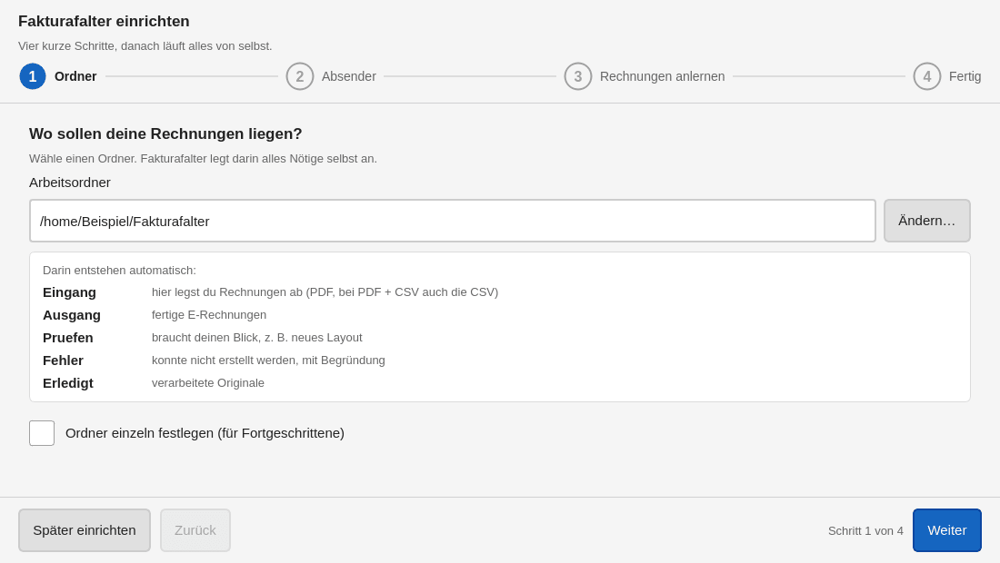
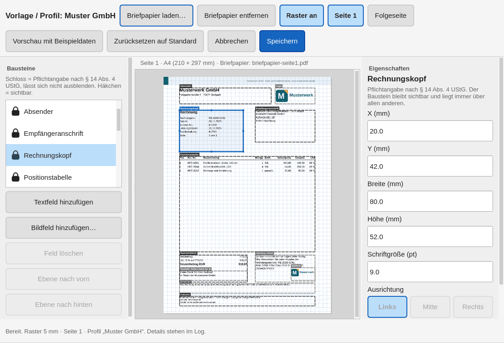
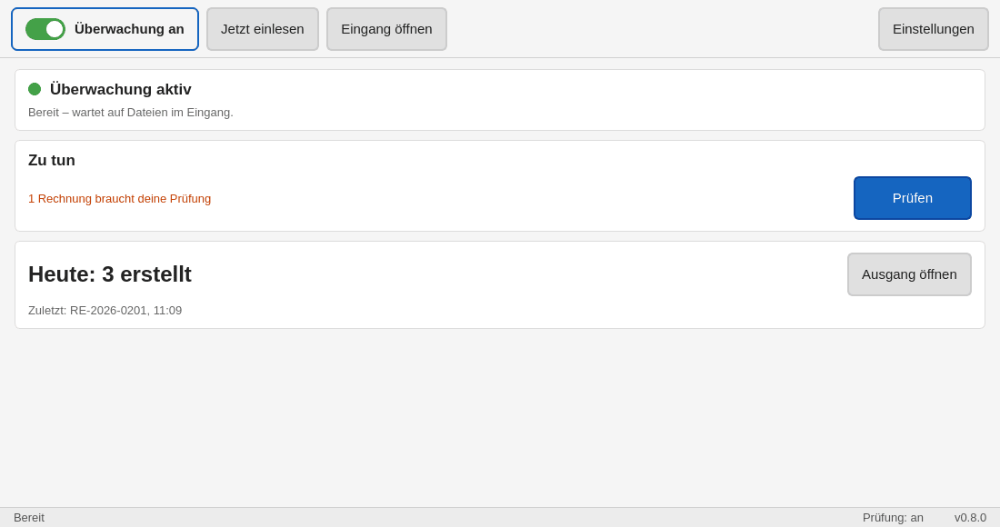
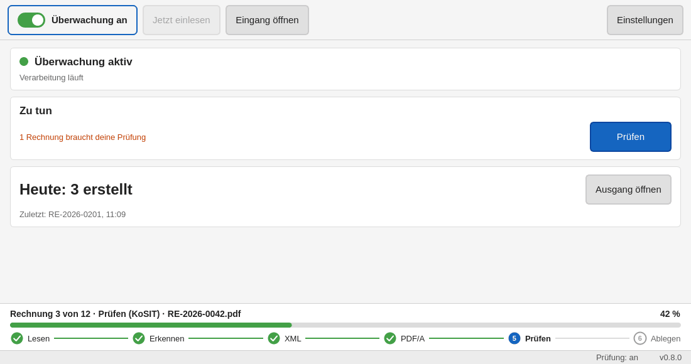
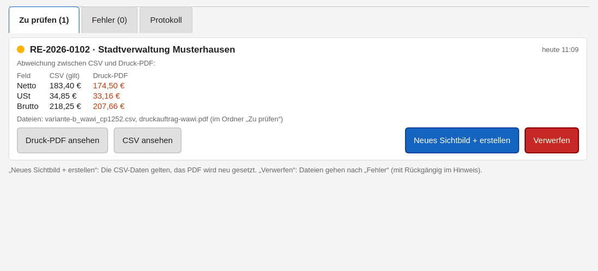
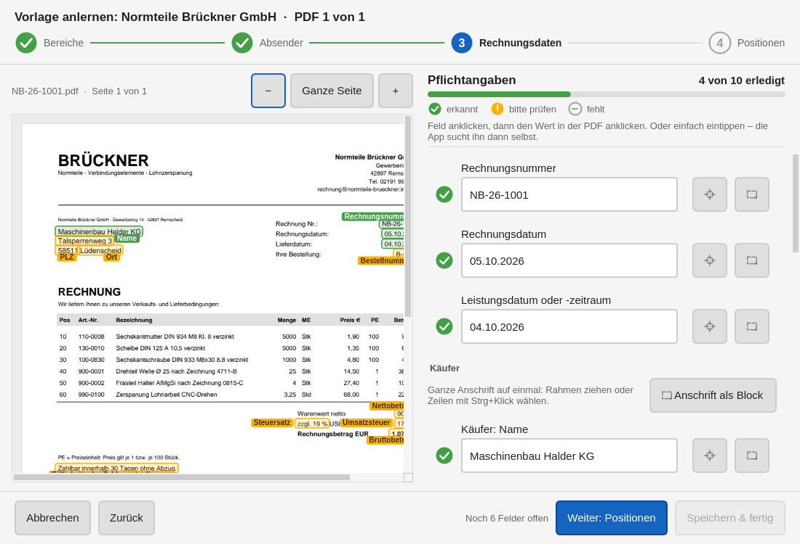

# Fakturafalter – Handbuch

Kurze Anleitung für den Alltag. Die Kernfunktion: Du legst **CSV-** oder **XML-Exporte**
in einen Ordner, Fakturafalter erzeugt daraus **ZUGFeRD-Rechnungen** (Profil EN 16931,
PDF/A-3 mit eingebettetem XML) und prüft sie lokal. Den sichtbaren Teil gestaltest du
im Layout-Editor, wenn die Sichtseite neu gebaut wird.

Die kurze Übersicht mit Bildern steht in der [README](../README.md).
Technische Einzelheiten stehen in [details.md](details.md) und [csv-format.md](csv-format.md).

Alle Beispiele und Screenshots in diesem Handbuch nutzen erfundene Daten.

## 1. Installation

Unter [Releases](https://github.com/deciderino/fakturafalter/releases) liegen
ein Linux-AppImage und ein portables Windows-ZIP. Beide bringen eine eigene
Java-Laufzeit und die Prüfwerkzeuge (Mustang/veraPDF und KoSIT) mit.
Es ist nichts extra zu installieren.

- **Linux:** Die Datei `Fakturafalter-…-x86_64.AppImage` ausführbar machen
  (`chmod +x …`) und starten, zum Beispiel per Doppelklick oder im Terminal.
- **Windows:** Das ZIP entpacken und `fakturafalter.exe` starten.
  Eine Installation in Windows ist nicht nötig; der Ordner darf auf dem
  Rechner oder einem Laufwerk liegen.

Beim ersten Start führt ein kurzer Assistent durch Arbeitsordner und Absender.

## 2. Ersteinrichtung

Der Assistent hat vier Schritte: **Ordner** → **Absender** → **Woher kommen deine Rechnungsdaten?** → **Fertig**.

1. **Arbeitsordner.** Fakturafalter legt darin selbst die Unterordner an:
   `Eingang` (neue Dateien), `Ausgang` (nur fertige E-Rechnungen),
   `Erledigt` (verarbeitete Quellen), `Pruefen` (Rechnungen, die du ansehen sollst),
   `Fehler` und `Protokoll` (`protokoll.tsv`, alle Vorgänge).
2. **Absender.** Dein Unternehmen, das die Rechnungen ausstellt. Am schnellsten:
   „Aus einer Rechnung (PDF) übernehmen…“ oder „Aus Datei importieren…“.
   Prüfe danach, ob die Pflichtfelder vollständig sind (siehe Abschnitt 8).
   Fehlt der Verkäufer in einer XML, gilt dieser Absender. Bei CSV kann ein Profil
   einen eigenen Verkäufer haben; sonst gilt ebenfalls dieser Absender.
3. **Woher kommen die Daten?** Wähle **CSV** oder **XML (ZUGFeRD / XRechnung)**
   und richte bei CSV eine Beispiel-Datei ein (Abschnitt 3). **Nur PDF**
   (Abschnitt 9) ist ein eigener Weg, wenn du fertige Rechnungs-PDFs verarbeiten
   willst; CSV oder XML sind zuverlässiger.
4. **Fertig.** Danach kannst du die Überwachung einschalten und Dateien in den
   Eingang legen.

„Später einrichten“ ist jederzeit möglich; das Hauptfenster zeigt dann, was noch fehlt.
Einstellungen lassen sich später unter **Einstellungen** ändern.

## 3. Schnellstart: CSV

1. Einstellungen → **Eingang & Vorlagen** → Eingangsformat **CSV**.
2. **Neue CSV einrichten…** Eine echte Export-Datei aus der Warenwirtschaft (ERP)
   wählen (sie wird nur gelesen). Der Zuordnung einen Namen geben und **Weiter**.
3. **Format:** Trennzeichen, Zeichensatz, Dezimalzeichen und Datumsformat sind
   erkannt. Passt die Vorschau nicht, stelle sie um. Unter **Aufbau** kannst du
   festlegen, ob jede Zeile eine Position ist, die Datei **Blöcke mit eigener
   Kopfzeile** hat oder eine Satzart-Spalte Kopf und Positionen trennt.
   Fakturafalter schlägt den erkannten Aufbau vor.
4. **Vorschau:** Über jeder Spalte steht, wofür Fakturafalter sie nimmt.
   Stimmt etwas nicht, wähle das Feld um. Unklare Steuerwerte bleiben auf
   „prüfen“. Bei Blöcken typisierst du die erkannten Blöcke (Kopf, Positionen,
   Zahlung …) und ordnest die Spalten je Block zu. Textzeilen ohne Menge und
   Preis hängen standardmäßig als Beschreibung (BT-154) an der Position darüber;
   eine gewollte Leerzeile auf der Sichtseite erkennst du mit dem Platzhalter
   `#LEER` (änderbar) oder einer Zeile, die nur Kopffelder trägt.
5. Nur beim Standardaufbau („eine Zeile je Position“): **Textzeilen** (ob
   Kommentare oder gewollte Leerzeilen vorkommen; 0 und 0,00 gelten als leer;
   Vorschau, wie die Zeilen erkannt werden) und **Darstellung auf der Rechnung**
   (Positionsnummer, Menge exakt wie in der CSV, Einheit, Schalter
   „Fehlende Einheit = Stück verwenden“, Bezeichnungen auf der
   PDF, optionale Felder ausblenden). Die Vorschläge übernimmst du mit Weiter.
   Später erreichst du die Darstellung auch über **Darstellung…** an der
   Profilkarte, ohne den ganzen Assistenten.
6. **Probe:** zeigt je Rechnung „bereit“ oder „braucht Prüfung“ – es wird
   nichts erzeugt. Optional **Sichtseite ansehen…**. Dann **Speichern**. Die
   Zuordnung erscheint als Karte unter „CSV-Zuordnungen“.
7. Den Haken **„Zusätzlich das PDF der Rechnung verwenden“** nur setzen, wenn
   der Original-Druck die Sichtseite bleiben soll. Ohne Haken (Standard für eine
   neue CSV-Einstellung) baut Fakturafalter die Sichtseite aus den Daten neu
   (Layout unter Absender → „Layout gestalten…“) und wartet nicht auf ein PDF.
   Liegt trotzdem ein PDF mit gleichem Dateinamen daneben, wird es nicht als
   Sichtseite und nicht als eigene Rechnung genommen; es wandert mit der CSV
   nach `Erledigt`.
8. Schalter **Überwachung** einschalten und die CSV in den `Eingang` legen.

Satzart-Dateien richtet der Assistent ebenfalls ein, wenn eine Spalte „Satzart“
(oder ähnlich) erkannt wird; Feineinstellungen stehen in
[csv-format.md](csv-format.md).

### Profile in den Einstellungen (ab 0.9.8)

Jede Profilkarte zeigt, ob sie **aktiv** ist und welche Spalten oder Merkmale
sie erkennt. Du kannst ein Profil aus- und wieder einschalten, ohne es zu
löschen, und die Reihenfolge mit **Hoch** / **Runter** ändern. Passen mehrere
Profile zu einer Datei, gewinnt das **oberste aktive**. Protokoll und
Rechnungsseite nennen je Datei das verwendete Profil. Mit **Profil testen…**
wählst du eine CSV und siehst, welches Profil greifen würde und warum die
anderen nicht. Alle Profile, auch mitgelieferte, sind bearbeit- und löschbar.
Beispielprofile (Varianten a/b/c/d/k/s und das Block-Beispiel) liegen im
Testdaten-ZIP und lassen sich mit **Profil übernehmen…** in deine Konfiguration
holen; eine frische Installation startet ohne diese Beispiele.

## 4. Schnellstart: XML

1. Einstellungen → **Eingang & Vorlagen** → **XML (ZUGFeRD / XRechnung)**.
   Eine Zuordnung ist nicht nötig. Erkannt werden ZUGFeRD/Factur-X und
   XRechnung, jeweils als CII oder UBL.
2. Optional **Probe mit einer XML…**: So würde Fakturafalter die Rechnungen
   lesen, ohne etwas zu erzeugen oder zu verschieben.
3. Wie bei CSV: Haken nur, wenn ein Original-PDF die Sichtseite sein soll.
   Ohne Haken wird die Sichtseite neu gebaut.
4. Überwachung an, XML in den `Eingang` legen. Fehlt der Verkäufer in der XML,
   gilt der Absender aus den Einstellungen.

Andere XML-Formate (zum Beispiel DATEV oder Lexware) werden nicht gelesen;
die Datei kommt mit Begründung in den Fehlerordner.

## 5. Layout-Editor

Den **Layout-Editor** öffnest du unter Einstellungen → Absender →
„Layout gestalten…“. Er bestimmt den sichtbaren Teil der *erzeugten*
Rechnung, wenn die Sichtseite neu gebaut wird – typischerweise bei CSV oder
XML ohne den Haken „Zusätzlich das PDF der Rechnung verwenden“, oder wenn
unter Ausgabe das Sichtbild „Immer neu erzeugen“ steht.

Links die Bausteine (ein Schloss kennzeichnet Pflichtangaben nach § 14 Abs. 4
UStG), in der Mitte die Seite mit Beispieldaten, rechts die Eigenschaften in mm.
Zwei Pflichtbausteine übereinander bekommen rote Rahmen; Speichern geht dann
nicht. Du kannst Logo und Briefpapier laden, Text- und Bildfelder hinzufügen
und die Reihenfolge der Ebenen ändern.

Ohne eigene Vorlage gilt das Standardlayout. Die strukturierten Rechnungsdaten
(XML) ändern sich durch das Layout nicht.

**Positionstabelle (ab 0.9.5).** Die Hauptzeile hat die Spalten Pos,
Bezeichnung, Menge, Einheit, Einzelpreis, Gesamt und USt; eine eigene Spalte
Art.-Nr. gibt es nicht mehr. Artikelnummer, Ihre Artikelnummer,
Zeichnungsnummer mit Index und GTIN stehen klein und grau unter der
Bezeichnung, darunter Beschreibung, Merkmale, Ursprungsland, Bestellposition,
Kostenstelle, Objekt, Leistungszeitraum, Hinweis sowie Rabatt und Zuschlag der
Position – jeweils nur, wenn ein Wert da ist. Lange Werte brechen um, nichts
wird abgeschnitten. **Kundenbezeichnung 1–3** aus der CSV stehen im
Adressblock je in einer eigenen Zeile (siehe [csv-format.md](csv-format.md)).

## 6. Automatische Prüfungen

Jede erzeugte E-Rechnung wird standardmäßig **lokal** nachgeprüft
(Einstellungen → Prüfung → „Nach Erstellung prüfen“), bevor sie in den Ausgang
kommt. Rechnungsdaten gehen dabei nie ins Internet, und zur Laufzeit wird
nichts nachgeladen.

- **Mustang** (mit veraPDF) prüft den PDF/A-3-Aufbau und den ZUGFeRD-Rahmen.
  „Gültig“ nur, wenn veraPDF die Datei als konform meldet.
- **KoSIT-Validator** mit der XRechnung-Konfiguration prüft die Rechnungsdaten
  nach EN 16931, also die eingebettete `factur-x.xml` und eine eventuelle
  zusätzliche XRechnung.

Erzeugt und geprüft wird in einem eigenen Ordner im System-Temp, der danach
gleich wieder gelöscht wird. **Gültig** kommt in den Ausgang. **Ungültig** geht
mit Begründung direkt nach `Fehler` und erscheint nie im Ausgang.
Kann die Prüfung technisch nicht laufen (Werkzeuge nicht gefunden), wird die
Rechnung trotzdem erzeugt, der Status ist dann „nicht geprüft“.

Zusätzlich laufen vor der Ausgabe **Pflicht- und Plausibilitätsprüfungen**
(unter anderem Summen, fehlende Pflichtfelder, Gutschrift oder Korrektur ohne
Rechnungsbezug BT-25, Betrag nicht positiv). Unklares landet in **Zu prüfen**,
nicht still im Ausgang.

In den fertigen Paketen liegt alles im Ordner `werkzeuge/` neben dem Programm
(Java-Laufzeit, Mustang, KoSIT 1.6.3, Konfiguration XRechnung 3.0.2).
Du kannst vorhandene Dateien auch gezielt prüfen:

    fakturafalter --pruefe datei.pdf datei.xml

Die eingebaute Prüfung ersetzt nicht deine eigene Kontrolle vor dem Versand.

## 7. Ablauf: Eingang → Ausgabe

Unter **Einstellungen → Eingang & Vorlagen** stellst du das **Eingangsformat** ein:
**CSV** oder **XML (ZUGFeRD / XRechnung)**, bei Bedarf mit dem Haken auf das
Original-PDF. **Nur PDF** siehe Abschnitt 9.

1. Schalter **Überwachung** einschalten.
2. Dateien in den Ordner `Eingang` legen: die CSV bzw. XML, optional das PDF,
   wenn der Haken gesetzt ist.
3. Fakturafalter liest, erzeugt die E-Rechnung, prüft sie lokal und
   legt sie ab.
4. Fertige Dateien liegen im `Ausgang`, die Quellen wandern nach `Erledigt`.
   Das Protokoll `protokoll.tsv` im Ordner `Protokoll` hält Nummer, Status und
   Prüfstand fest.

**Ausgang als Postbox.** In den Ausgang kommt nur die fertige, geprüfte Datei,
und zwar in einem Schritt (keine halben oder temporären Dateien). Gibt es eine
XRechnung dazu, kommt sie vor der PDF. Ein Archiv, das den Ausgang überwacht,
ein anderes Programm oder du selbst darf den Ausgang jederzeit leeren – auch
`Erledigt`. Die Doppelprüfung stützt sich auf das Protokoll, nicht auf den
Ausgang.

**Protokoll.** `protokoll.tsv` liegt im Ordner `Protokoll` im Arbeitsordner;
einen anderen Ort wählst du unter Einstellungen → Ordner → **Protokollordner**.
Jede Rechnung wird sofort eingetragen. Ist die Datei gerade geöffnet (z. B. in
Excel), merkt sich Fakturafalter die Zeilen in `protokoll-nachtrag.tsv` und
trägt sie beim nächsten Lauf nach. Fehlt das Protokoll, obwohl es schon
Rechnungen gab, erscheint nur ein Hinweis – die Verarbeitung läuft weiter.
Ein altes `protokoll.tsv` im Ausgang (bis Version 0.9.5) wird nicht mehr
gelesen; wer die alten Nummern für die Doppelprüfung behalten will, kopiert es
vor dem ersten Lauf in den Ordner `Protokoll`.

**XRechnung-Datei.** Unter Einstellungen → Ausgabe wählst du, wohin die
zusätzliche XRechnung kommt: neben die PDF in den Ausgang (Standard), in den
Unterordner `XRechnung` des Ausgangs oder gar nicht.

Mit Haken startet die Verarbeitung, sobald PDF und CSV bzw. XML mit gleichem
Namen im Eingang liegen. Bis dahin zeigt die Karte „Zu tun“, dass auf das
Gegenstück gewartet wird. Kommt die zweite Datei nicht, geht die erste nach
der eingestellten Wartezeit (Standard 10 Minuten, 0 = nicht warten) allein
in den Lauf (Paarung über die Rechnungsnummer).

Während der Verarbeitung siehst du den Fortschritt (zum Beispiel
„Rechnung 3 von 12 · Prüfen mit KoSIT“).

Status kurz:

- **Erstellt / ok** – E-Rechnung liegt im Ausgang.
- **Zu prüfen** – etwas Unklares oder Unvollständiges; die Datei geht nicht
  ungesehen raus.
- **Fehler** – Erzeugung oder lokale Nachprüfung ist gescheitert. Begründung
  liegt bei den Dateien im Ordner `Fehler`, technische Details in der Logdatei.

Über **Zu tun** bzw. **Prüfen** öffnest du die Prüfansicht. Hinweise erscheinen
in der Oberfläche und im Protokoll, **ohne** extra Fenster. Die technischen
Einzelheiten stehen in der **Logdatei** (Schaltfläche „Logdatei öffnen“ in der
Prüfansicht, oder der Ordner `logs/` neben der Konfiguration).

In der Prüfansicht kannst du die Rechnung ansehen, verwerfen (Dateien nach
`Fehler`) oder – je nach Fall – mit einem neuen Sichtbild erstellen lassen.
Die Pflichtprüfung läuft dabei erneut.

### Dateiname und Rechnungsnummer (ab 0.9.5)

Die Rechnungsnummer kommt **immer aus der CSV bzw. XML**, also aus deiner
Warenwirtschaft. Fakturafalter vergibt keine Nummern und ändert sie nie. Unter
**Einstellungen → Ausgabe → „Dateiname und Rechnungsnummer“** stellst du je
Belegart (Rechnungen, Gutschriften) ein:

- **Dateiname der ZUGFeRD-PDF** und der XRechnung-XML mit Platzhaltern:
  `{rechnungsnummer}`, `{jahr}`, `{monat}`, `{tag}`, `{datum}` (JJJJ-MM-TT),
  `{kundennummer}`, `{kunde}` (Name, gekürzt auf 40 Zeichen), `{belegart}`
  (Rechnung, Gutschrift …), `{belegart_kurz}` (RE, GS …). Beispiel:
  `{jahr}_{rechnungsnummer}_{kunde}` → `2026_2026000101_Feinmechanik_Beispiel_GmbH.pdf`.
  Umlaute werden umschrieben (ä → ae), Zeichen, die Windows oder Linux nicht
  mögen, durch `_` ersetzt. Die Vorschau unter den Feldern zeigt das Ergebnis
  beim Tippen. Leer = wie bisher (`<Nummer>_zugferd.pdf`); bei Gutschriften
  heißt leer „wie bei Rechnungen“.
- **Prüfmuster** (optional): `JJJJ` = Jahr, `JJ` = Jahr zweistellig,
  `MM` = Monat, `#` = eine Ziffer, `*` = beliebige Zeichen, alles andere wörtlich
  (Groß-/Kleinschreibung egal). Beispiele: `JJJJ######` für `2026000101`,
  `RE-JJJJ-####` für `RE-2026-0042`, `GS-JJJJ-####` für Gutschriften. Passt
  eine Nummer nicht, geht die Rechnung nach **Zu prüfen**.
- **Lücken melden** (nur mit Prüfmuster mit `#`): Fehlen Nummern zwischen der
  letzten bekannten und der neuen (der letzte `#`-Block zählt, Jahr bzw.
  Präfix bilden den Kreis), erscheint eine **Warnung**. Die Rechnung läuft
  trotzdem durch – Lücken sind erlaubt.

Doppelte Rechnungsnummern hält Fakturafalter wie bisher immer an. Gibt es eine
Datei mit dem gebildeten Namen schon im Ausgang, wird nichts überschrieben: die
Rechnung geht nach „Zu prüfen“. In der `konfiguration.yaml` steht das unter
`optionen.nummernkreise` (Beispiel als Kommentar in `beispiele/konfiguration.yaml`);
ohne diesen Block bleibt alles wie bisher.

## 8. Absenderprofil

Diese Felder musst du typischerweise ausfüllen, wenn der Verkäufer nicht schon
vollständig in der CSV bzw. XML steht:

| Feld im Profil | Warum | Quelle |
|---|---|---|
| Firmenname | Name des leistenden Unternehmers | § 14 Abs. 4 Nr. 1 UStG; EN 16931 BT-27 |
| Straße und Hausnummer, PLZ, Ort | Vollständige Anschrift des Verkäufers | § 14 Abs. 4 Nr. 1 UStG; EN 16931 BT-35, BT-38, BT-37, Land BT-40 (Standard: DE) |
| USt-IdNr. **oder** Steuernummer | Steuerliche Identifikation des Verkäufers | § 14 Abs. 4 Nr. 2 UStG; EN 16931 BT-31 bzw. BT-32 |
| Handelsregister | Nur nötig, wenn du **keine** USt-IdNr. angibst, sondern nur die Steuernummer | EN 16931, BR-CO-26 (BT-30) |
| Kleinunternehmer (Schalter, ab 0.9.7) | Alle Rechnungen ohne Umsatzsteuer mit Hinweis nach § 19 UStG; siehe Abschnitt 11 | § 19 UStG; EN 16931 Kategorie E |
| IBAN | Bei Zahlung per Überweisung | EN 16931, BR-61 (BT-84) |

Freiwillig, aber sinnvoll: BIC, Adresszusatz (BT-36), Ansprechpartner, Telefon
und E-Mail. Für den üblichen B2B-Einsatz mit ZUGFeRD (Profil EN 16931) sind
sie nicht Pflicht. Sie werden erst relevant, wenn du später an Behörden
XRechnungen schickst.

Die Angaben zum **Käufer**, das Rechnungsdatum, die Rechnungsnummer, das
Leistungsdatum, die Positionen und die Summen kommen bei CSV und XML aus den
Daten. Auch sie sind Pflicht (§ 14 Abs. 4 Nr. 1 und 3–8 UStG; EN 16931 unter
anderem BT-1, BT-2, BT-72 oder BG-14, BG-25, BG-23). Fehlt etwas oder stimmt
eine Summe nicht, geht die Datei nach `Pruefen` oder `Fehler`.

Quellen: [§ 14 Abs. 4 UStG](https://www.gesetze-im-internet.de/ustg_1980/__14.html);
EN 16931-1 (Pflichtfelder und BR-61, BR-CO-25, BR-CO-26).

## 9. Nur PDF

Fakturafalter kann aus einem fertigen Rechnungsdruck eine gültige ZUGFeRD-Rechnung
erzeugen: allein aus einem Druck-PDF mit Textebene (keine reinen Scans, keine OCR).
Das Layout lernst du einmal an, danach gilt derselbe Ablauf über den Eingangsordner
und dieselben Pflicht- und Validierungsprüfungen wie bei CSV und XML. Bei Unsicherheit
landet die Rechnung in „Zu prüfen“.

CSV- oder XML-Export ist zuverlässiger und der bessere Weg. Die Erkennung hängt am
angelernten Layout und kann fehlgehen; die Vorlage muss zum Druck passen, und die
Ergebnisse solltest du kontrollieren, bevor du sie verschickst.

### Anlernen

Unbekannte Druck-PDFs landen in einer Warteschlange. Das Hauptfenster zeigt
dann zum Beispiel „8 Rechnungen warten aufs Anlernen“. Über **Anlernen**
öffnest du den Assistenten.

Typischer Ablauf:

1. **Bereiche festlegen** (freiwillig): Rahmen um Anschrift, Rechnungskopf,
   Positionstabelle, Summen und Zahlungsbedingungen ziehen. Gelesen wird dann
   nur in diesen Rahmen.
2. **Absender prüfen**, falls er aus dem Druck erkannt wurde, oder den
   passenden Absender wählen. Im Nur-PDF-Modus kommt der Verkäufer typischerweise
   aus der Vorlage bzw. dem Absenderprofil.
3. **Rechnungsdaten:** Grün heißt erkannt. Jedes Feld mit „Passt“ bestätigen.
   Fehlt etwas, das Feld anklicken und den Wert im PDF anklicken oder eintippen.
4. **Positionen:** Tabelle und Spalten prüfen. Die Summe der Positionen muss
   zum Netto passen.
5. **Speichern & nächste PDF.** Ab der zweiten Rechnung desselben Layouts ist
   fast alles erkannt.

Nach mehreren Rechnungen in Folge ohne Korrektur (Standard: 5) kannst du unter
Einstellungen → Eingang & Vorlagen **„Automatisch, ohne Nachfrage“**
einschalten. Ab dann reicht das PDF allein. Pflichtangaben- und Summenprüfung
laufen trotzdem bei jeder Rechnung.

Die Vorlage gilt für ein festes Layout. Ändert sich der Druck (anderes Programm,
stark verschobene Felder), lernst du das Layout neu an.

### Selbstkontrolle

Nach dem Speichern einer Vorlage prüft die App, ob sie die bestätigten Felder
mit den neuen Regeln wieder genauso liest. Weicht etwas ab, merkt sie sich das
in der Vorlage – nicht nur für die nächste PDF derselben Sitzung.

Spätere Rechnungen dieses Absenders halten in der Prüfansicht an; die
betroffenen Felder tragen den Hinweis „prüfen“. Im Anlern-Assistenten
sind die Felder ebenso markiert. Für die Positionen (es gibt keine einzelne
Feldzeile) steht der Hinweis an der Sektion „Positionen“.

Wenn du die Abweichung geprüft und für in Ordnung befunden hast, kannst du
in der Prüfansicht **Felder bestätigen** wählen. Die offene Selbstkontrolle
der Vorlage wird dann ausgetragen. Dasselbe geschieht automatisch, sobald
eine erneut angelernte PDF desselben Absenders das Feld wieder richtig liest.
Vorlagen ohne diesen Eintrag (bis Version 0.8.0) gelten als bestätigt.

### Adresszusatz beim Käufer

In der Käuferanschrift liest die App Zusatzzeilen zwischen Firmenname und Straße
so (Beschluss 23.11.2026):

- **Abteilung, c/o, Gebäude** und ähnliche Vermerke unter dem Namen werden
  **Adresszeile 2 (BT-51)**. Eine zweite solche Zeile wird **Adresszeile 3 (BT-163)**.
- **„z. Hd.“ / „zu Händen“ / „Attn.“** geht in die **Kontaktstelle (BT-56)**,
  nicht in den Firmennamen (BT-44).
- Steht über der Straße nur ein Vermerk, kein Firmenname, bleibt der Vermerk
  im Namen (wie bisher). Die Rechnung hält mit dem Hinweis „prüfen“ an.

Im Anlern-Assistenten siehst du Kontaktstelle und Adresszeile 3 als eigene
Felder. Wenn du Name oder Zusatz änderst, bleiben sie stehen und können
korrigiert werden. In der erzeugten Rechnung stehen sie in der CII-Anschrift
(`ram:LineTwo`, `ram:LineThree`) bzw. als Ansprechpartner
(`DefinedTradeContact/PersonName`) und im Sichtteil.

Die Lieferanschrift kommt im Betrieb nicht vor und wird nicht angelernt.

## 10. Gutschrift

Gemeint ist die kaufmännische **Gutschrift / Credit Note, Typ 381**
(UNTDID 1001), nicht die Selbstfakturierung nach § 14 Abs. 4 Nr. 10 UStG
(Typ 389).

In EN 16931 sind die Beträge einer Gutschrift **positiv**; das Vorzeichen
steckt in der Belegart (BR-27). Eine Berichtigung muss sich eindeutig auf die
ursprüngliche Rechnung beziehen (§ 31 Abs. 5 UStDV). Deshalb verlangt
Fakturafalter bei Typ 381 und 384 die Nummer der Ursprungsrechnung (BT-25).
Fehlt sie, oder ist der Rechnungsbetrag nicht positiv, hält die Pflichtprüfung
die Datei an – mit einem Hinweis, ohne Popup.

Per **CSV oder XML** erzeugst du Gutschriften mit Belegart 381 und einer
Spalte bzw. einem Feld für BT-25 (siehe [csv-format.md](csv-format.md)).

### Im Nur-PDF-Modus anlernen

Im Anlern-Assistenten gibt es unter **Rechnungsdaten** die Sektion **Gutschrift**
mit zwei freiwilligen Feldern. Beide haben den Knopf „Bereich ziehen“
(Rahmen um den Wert in der PDF):

- **Belegart: Titel im Druck.** Rahmen um den Titel (zum Beispiel das Wort
  „Gutschrift“ oder „Rechnung“) ziehen. Steht im Titel das Wort „Gutschrift“,
  setzt Fakturafalter die Belegart 381, sonst 380. Ohne diesen Rahmen bleibt
  es bei einer normalen Rechnung (380).
- **Bezug: Nummer der Ursprungsrechnung.** Nur bei einer Gutschrift nötig.
  Rahmen um die Bezugszeile ziehen (zum Beispiel „NB-26-0990 vom 01.10.2026“).
  Die Nummer wird zu BT-25, ein Datum in derselben Zeile zu BT-26.

Ein Hinweis unter den Feldern sagt, welche Belegart erkannt wurde. Fehlt bei
einer Gutschrift der Bezug, erinnert der Hinweis daran, den Rahmen zu ziehen –
ohne Bezug darf die Gutschrift nicht einfach rausgehen.

**Weicht der Kopf der Gutschrift vom üblichen Rechnungslayout ab**
(anderer Titel, andere Position der Bezugszeile, verschobene Felder), lernst du
die Gutschrift als **eigene Vorlage** an, nicht in dieselbe Vorlage wie die
normalen Rechnungen. Sonst trifft die Erkennung den Titel oder den Bezug nicht
zuverlässig.

Nach dem Anlernen gilt dasselbe für weitere Gutschriften desselben Layouts,
sobald „Automatisch, ohne Nachfrage“ eingeschaltet ist. Prüfe die erste
automatisch erzeugte Gutschrift trotzdem in der Prüfansicht, bevor du sie
verschickst.

## 11. Steuer-Sonderfälle, Fremdwährung und Leitweg-ID (ab 0.9.7)

### Steuerfälle

Neben der Regelbesteuerung (19 % / 7 %, Kategorie S) erzeugt Fakturafalter diese Fälle:

| Fall | Kategorie | Pflicht auf der Rechnung | Was Fakturafalter prüft |
|---|---|---|---|
| Reverse Charge (§ 13b UStG) | AE | Hinweis „Steuerschuldnerschaft des Leistungsempfängers“ | USt-IdNr. oder Steuernummer des Verkäufers, USt-IdNr. des Käufers empfohlen |
| Innergemeinschaftliche Lieferung | K | Hinweis auf die Steuerbefreiung | USt-IdNr. von Verkäufer **und** Käufer, Lieferland in einem anderen EU-Land |
| Ausfuhr (Drittland) | G | Hinweis auf die Steuerbefreiung | USt-IdNr. des Verkäufers |
| Nicht im Inland steuerbar | O | Hinweis | keine anderen Kategorien in derselben Rechnung; die USt-IdNr. bleibt nur in der XML weg (BR-O-02), der Briefkopf zeigt sie weiter |
| Kleinunternehmer (§ 19 UStG) | E | „Gemäß § 19 UStG wird keine Umsatzsteuer berechnet.“ | kein Steuersatz > 0 in den Daten |

Ein Verkäufer mit Sitz im Ausland wird nicht unterstützt.

- **Gemischte Rechnungen** (z. B. eine Bauleistung mit Reverse Charge und eine Lieferung mit 19 %) gehen, wenn der
  Steuerfall je Position in den Daten steht. Nur „nicht steuerbar“ (O) darf nicht gemischt werden.
- **Den Hinweistext** nimmt Fakturafalter aus den Daten (Spalte bzw. Feld „Steuerhinweis“). Fehlt er, setzt es
  den Standardtext des Falls ein.
- **CSV:** In der Steuerspalte dürfen neben Sätzen auch Kennzeichen stehen („RC“, „igL“, „EX“, „§19“ usw.); im
  CSV-Assistenten wählst du je Wert den Fall. Siehe [csv-format.md](csv-format.md#steuerfälle-und-fremdwährung-ab-097).
- **XML:** Die Kategorien AE/K/G/O/E werden aus ZUGFeRD/XRechnung (CII und UBL) übernommen.

**Kleinunternehmer:** Einstellungen → Absender, Haken **„Kleinunternehmer (§ 19 UStG)“**. Dann steht auf jeder
Rechnung der § 19-Hinweis, in den Summen nur der Gesamtbetrag. Für die E-Rechnung braucht der Absender eine
USt-IdNr. oder eine Steuernummer **mit** Handelsregisternummer (BR-CO-26); fehlt das, hält
Fakturafalter mit einem Hinweis an. Liefert eine Quelle trotzdem einen Steuersatz über 0 %, geht die Rechnung
nach „Zu prüfen“ – nichts wird still überschrieben.

### Im Nur-PDF-Modus anlernen

Der Anlern-Assistent hat dafür den Bereich **„Steuerhinweis & Kennungen“** (Schritt 1, freiwillig): Rahmen um
den Steuerhinweis, die USt-IdNr. des Kunden, Land, Leitweg-ID, Währung und Kurs ziehen. Ohne Rahmen sucht
Fakturafalter den Hinweis, die Währung an den Beträgen und eine Kurszeile („1 EUR = 1,0850 USD“) selbst.

Unter **Positionen** wählst du den **Steuerfall**:

- **Steuerspalte im Druck** (z. B. „19 %“, „0 %“, „RC“): Die Spalte als **„USt-Satz“** zuordnen (Spaltenrahmen).
  Je Wert erscheint eine Auswahl, was er bedeutet. „0 %“ ohne Kennzeichen gilt als „aus dem Steuerhinweis je
  Rechnung“ – so liest dieselbe Vorlage Reverse-Charge- und igL-Rechnungen. Gemischte Rechnungen gehen.
- **Satz nur in den Summen:** ein Steuerfall je Rechnung. Bei „automatisch“ entscheidet der Steuerhinweis im
  Druck; fehlt er, gilt der Satz aus der Summenzeile („zzgl. 19 % USt“).
- **Fester Fall** (z. B. Kleinunternehmer): in der Auswahl festlegen. „Kleinunternehmer“ setzt auch den Schalter
  am Absender.

Widerspricht der Druck der Vorlage (Hinweis „Reverse Charge“, aber Umsatzsteuer berechnet, oder umgekehrt),
geht die Rechnung nach „Zu prüfen“. Eine Auslandsanschrift erkennt Fakturafalter, wenn unter „PLZ Ort“ eine
Landzeile steht („Österreich“, „Schweiz“, „USA“); das Land wird dann zum Käuferland (BT-55).

Ein durchgespieltes Beispiel mit allen Fällen liegt in [beispiele/steuerfaelle](../beispiele/steuerfaelle/README.md).

### Fremdwährung

Rechnungen in einer anderen Währung als EUR (Feld „Währung“, BT-5) brauchen die Umsatzsteuer zusätzlich in EUR
(§ 14 Abs. 4 Nr. 8 und § 16 Abs. 6 UStG, Art. 230 MwStSystRL). Fakturafalter nimmt dafür

- den **Kurs** „1 EUR = x Fremdwährung“ aus den Daten (Spalte/Feld „Kurs“, optional „Kursdatum“) oder
- die **Umsatzsteuer in EUR** (BT-111) aus den Daten.

Fakturafalter **ruft keinen Kurs ab**. Fehlt beides, geht die Rechnung nach „Zu prüfen“. Stehen beide da und
passen nicht zusammen, ebenso. Die XML erhält die Steuerwährung EUR (BT-6) und den Betrag in EUR (BT-111), die
Sichtseite zeigt „Gesamtbetrag USD“ und „Umsatzsteuer in EUR: … (Umrechnungskurs …)“. Warnungen (ohne Anhalten):
SEPA-Zahlung bei Fremdwährung, Kursdatum älter als zwei Monate.

### Leitweg-ID

Die Leitweg-ID (BT-10) kommt aus der Quelle (Feld „Leitweg-ID“) oder dem Kundenstamm (Spalte `leitweg_id_bt10`),
sonst wie bisher die Kundennummer als
Käuferreferenz. Sieht der Wert wie eine Leitweg-ID aus (z. B. `04011000-12345-03`), prüft Fakturafalter Aufbau und
Prüfziffer (Mod 97-10) streng; eine falsche Leitweg-ID geht nach „Zu prüfen“. Andere Werte (Kundennummern)
werden nicht als Leitweg-ID geprüft.

## 12. Logs, Anonymisieren und Updateprüfung

Die Logdatei liegt im Ordner `logs/` neben der Konfiguration
(rotierend, typisch 1 MB × 5 Dateien). Dort stehen die technischen Details,
nicht in der Oberfläche.

Unter Einstellungen → Allgemein → Datenschutz kannst du **„Logs anonymisieren“**
einschalten. Dann erscheinen Namen, Anschriften, IBAN, USt-IdNr., E-Mail-Adressen
und Beträge als Platzhalter wie `[Name]` oder `[IBAN]`. Das gilt ab dem
Einschalten; ältere Zeilen bleiben unverändert. Gut, bevor du ein Log
weitergibst.

Das Protokoll `protokoll.tsv` im Ordner `Protokoll` ist keine Logdatei und
bleibt vollständig.

### Updateprüfung

Beim Start fragt Fakturafalter im Hintergrund bei GitHub nach, ob es eine
neuere Version gibt. Das ist der einzige Netzzugriff der App: Abgefragt wird
nur die aktuelle Versionsnummer, gesendet werden keine Daten. Ohne Netz bleibt
es still. Gibt es eine neuere Version, erscheint ein Hinweis mit Link zur
Release-Seite; heruntergeladen oder installiert wird nichts.

Einstellungen → Allgemein → **Updates**: „Beim Start nach Updates suchen“
(Standard an) abschalten, „Pre-Releases einbeziehen“ (Standard aus) oder
„Jetzt prüfen“. Im Hintergrundmodus (`--headless`) steht ein Hinweis nur in der
Logdatei.

## 13. Häufige Probleme

**Die Überwachung startet nicht / es fehlt noch etwas.**
Im Hauptfenster oder in den Einstellungen fehlt oft der Arbeitsordner oder
ein Pflichtfeld im Absender. Bei CSV fehlt möglicherweise noch eine Zuordnung.
Erst einrichten, dann den Schalter einschalten.

**CSV oder XML wird nicht verarbeitet.**
Prüfe das Eingangsformat unter Einstellungen → Eingang & Vorlagen. Für CSV
muss eine passende Zuordnung existieren. XML muss ZUGFeRD/Factur-X oder
XRechnung (CII oder UBL) sein. Steht der Haken „Zusätzlich das PDF verwenden“,
wartet die Überwachung auf das Gegenstück.

**Rechnung geht nach „Zu prüfen“.**
Den Hinweis in der Prüfansicht lesen. Häufig: unvollständiges Absenderprofil,
fehlendes Leistungsdatum, Summenabweichung oder Gutschrift ohne Rechnungsbezug.
Details stehen in der Logdatei.

**Rechnung geht nach „Fehler“, Prüfung „ungültig“.**
Den Fehlerbericht im Ordner `Fehler` öffnen (Regel und Kurzbeschreibung).
Den technischen Bericht findest du im Log. Die Datei nicht verschicken,
bis die Ursache behoben ist.

**Prüfung: Werkzeuge fehlen.**
Die fertigen Pakete bringen den Ordner `werkzeuge/` mit. Liegt er nicht neben
dem Programm, erscheint „Prüfung: Werkzeuge fehlen“. Die Rechnung kann trotzdem
erzeugt werden, ist dann aber nicht lokal nachgeprüft.

**PDFs bleiben im Eingang oder landen beim Anlernen (Nur PDF).**
Das Layout ist noch nicht angelernt, oder „Automatisch, ohne Nachfrage“ ist
noch aus. Einmal anlernen, mehrere Rechnungen bestätigen, dann die Automatik
einschalten – und die erzeugte Datei kontrollieren.

**Gutschrift kommt als normale Rechnung raus (Nur PDF).**
Ohne Rahmen um den Titel im Anlern-Assistenten bleibt typischerweise Typ 380.
Siehe Abschnitt 10. Die erste automatisch erzeugte Gutschrift solltest du in
der Prüfansicht gegenprüfen.

**Nur ein Scan, kein Text in der PDF.**
Fakturafalter liest die Textebene der PDF. Eine reine Bilddatei ohne Text
kann es nicht verarbeiten (OCR ist nicht vorgesehen).

**XRechnung / Leitweg-ID an Behörden.**
Der Standardweg ist ZUGFeRD im Profil EN 16931 und erfüllt die E-Rechnungspflicht
im B2B. Für Behörden trägst du die Leitweg-ID im Kundenstamm ein (Abschnitt 11);
eine XRechnung (CII) legt Fakturafalter zusätzlich ab, wenn der Kundenstamm sie
verlangt.

**„Rechnung in USD … Kurs oder USt in EUR fehlt“.**
Den Kurs oder die Umsatzsteuer in EUR in den Export aufnehmen (Abschnitt 11).
Fakturafalter rechnet nie mit einem selbst geholten Kurs.

## Rechtliches und Lizenz

Fakturafalter ist freie Software unter der [Apache-Lizenz 2.0](../LICENSE),
ohne Gewährleistung und ohne Support. Prüfe erzeugte Rechnungen, bevor du
sie verschickst.

Rechtsgrundlagen, auf die sich die Pflichtprüfung stützt:

- [§ 14 Abs. 4 UStG](https://www.gesetze-im-internet.de/ustg_1980/__14.html)
  (Pflichtangaben der Rechnung)
- [§ 31 Abs. 4 und Abs. 5 UStDV](https://www.gesetze-im-internet.de/ustdv_1980/__31.html)
  (Kalendermonat als Leistungszeitpunkt; Bezug bei einer Berichtigung)
- EN 16931-1 (Pflichtfelder, unter anderem BR-27, BR-61, BR-CO-25, BR-CO-26)
